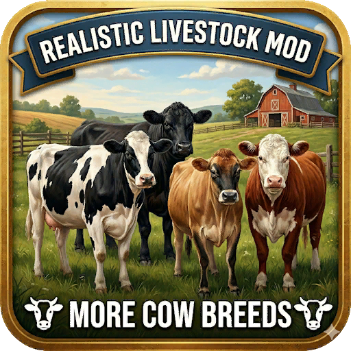

# FS25_CowBreedsRLRM

> [!NOTE]
> The [Ritter version of FS25 Realistic Livestock](https://github.com/rittermod/FS25_RealisticLivestockRM) is required for this mod to work.

A companion pack for **FS25 Realistic Livestock (RM)** that adds **13 new cow breeds** with their own textures, plus custom bull and calf models, per‑breed horns, and visual accessories for the base breeds. Breed economics (weight, feed, and outputs) are calibrated against RLRM's base breeds so each breed behaves the way you'd expect.

> [!WARNING]
> **Back up your save before installing.** Existing animals are migrated automatically on load, but migration **cannot guarantee every possible save state** — if an animal's breed can't be resolved, RLRM may drop it. Always test on a **copy** of your save first.
>
> **Map compatibility.** This pack replaces the game's cow husbandry configuration, so it will **not** work alongside maps that add their **own** extra cow breeds. It is **not compatible with Le Mechet** (its Charolaise / Simmental / Montbeliarde / Vosgienne breeds will not load), and the same likely applies to other breed‑adding maps. It **is** compatible with **Witcombe Park**.

## Requires
- **[FS25_RealisticLivestockRM](https://github.com/rittermod/FS25_RealisticLivestockRM)** — required. Tested against v1.4.2.0.
- **Beans and Alpacas DLC** — only for the Brahman; everything else works without it.

## The breeds

**Dairy (6)** — Red Holstein · Ayrshire · Jersey · Guernsey · Kerry · Shorthorn Milkers
**Beef (7)** — Red Angus · Charolais · Shorthorn · Irish Moiled · British Blue · Belted Galloway · Simmental

> Hereford is **not** a separate pack breed — it's folded into RLRM's own Hereford, which this pack re‑skins with custom models and textures (see *Compatibility*).

## Features

- **Custom bull (male) models** for the dairy, beef and Highland lines — males are no longer just the cow model.
- **Custom calf models**, including male calf variants, for dairy, beef and Highland.
- **Dairy breed sizes** — dairy cows and bulls are sized by breed: Holstein, Red Holstein and Brown Swiss at full size, Shorthorn Milkers, Ayrshire and Guernsey about 9% smaller, Jersey and Kerry about 18% smaller. Young stock (12–24 months) is a step smaller again, and pedigree bulls a size up. Each size moves with its own scaled animation.
- **Growing beef calves** — beef calves from 6 to 12 months come in four sizes, set by age (6–9 / 9–12 months) and the breed's height (compact, standard, tall), so they grow steadily into the young adults. Heifer, bull and steer calves each have their own body, with the breed's build and a lean / normal / heavy body that follows their weight. Bull calves show the scrotum and steers a smaller pouch, on bare skin. Baby beef calves are a size bigger from 3 months. Each size moves with its own scaled animation.
- **Growing dairy calves** — dairy calves grow the same way, on the same calf models with their own dairy coats: sized by age and the breed's dairy size (Jersey and Kerry the smallest, Holstein, Red Holstein and Brown Swiss the biggest), with heifer, bull and steer bodies that follow their weight. Dairy babies are a size bigger from 3 months too.
- **Baby calves** — newborns wobble on the unsteady baby walk for their first two months, then walk and run like calves from 2 months (the calf animations fitted to the baby). Bull babies show a small scrotum and steers a pouch, on bare skin, with a sheath — beef and dairy, at both baby sizes.
- **Per‑breed horns** — a runtime system picks the right horns per animal:
  - **Highland** — always horned.
  - **Swiss Brown, Kerry** — mostly horned.
  - **Hereford, Limousin, Charolais, Shorthorn, British Blue, Simmental** — occasionally horned (bulls more often than cows).
  - All other breeds — polled.
  - Each animal's horned/polled state is fixed for its life (seeded from its ID), so a herd shows a natural mix.
- **Beef sizes and builds** — adult beef cattle are sized by the breed's height (Belted Galloway and Irish Moiled compact, Charolais, Limousin and Simmental tall) and built native, continental or double‑muscled (British Blue), with a lean / normal / heavy body that follows each animal's weight. Young stock is a step smaller and pedigree bulls a size up.
- **Pedigree bulls** — an entire bull of 24 months or older with Very Good genetics or better may be a pedigree bull: about 1 in 4 of those has the type for it, fixed per bull by his ID. Pedigree bulls get the bigger pedigree model, a "Pedigree: Yes" line in the look‑at box, the RL menu and the Animals page, and a breeding‑stock price (see *Prices*).
- **Visual accessories on the base breeds** — monitors, ear tags, sprayed markers and nose rings are wired onto Holstein, Swiss Brown, Limousin, Angus, Hereford and Highland, as on the pack breeds.
- **Monitor collar** — a GEA‑style activity collar with the animal's last four ID digits on its tags, fitted to every adult body. Pedigree bulls and heavy adult bulls go without (the monitor still works). Monitors applied with "apply to all" show straight away.
- **Ear tags** — an Irish or UK style official number tag in the left ear and a name tag in the right. Switch with the console command `cowEarTags IE` or `cowEarTags UK`; the choice is saved.
- **Spray marks and bum IDs** fitted to each body's back and rump.
- **Custom Highland** textures and models (adult, kid, baby, plus bull variants).
- **Water Buffalo** models bundled and remapped through the pack atlases. Buffalo bulls and bull calves have male bodies (bare‑skin groin, scrotum and sheath).
- **Brahman** (Beans and Alpacas DLC) — fitted into the pack's model slots, with male bodies for bulls and bull calves.
- **Coats kept on update** — animals from an older version of the pack, or from plain RLRM, keep their coat.

## Breed value calibration

Every pack breed is anchored to RLRM's **base breeds** by size and type. Values below are the **peak (adult) per‑day** figures. Milk is set per breed's real dairy ability — dual‑purpose beef breeds keep a useful yield, pure‑beef breeds stay low.

**Base reference:** straw is a type constant (dairy `95`, beef/Highland `130`); base max weight is `1200` (cow) / `1400` (bull); dairy milk ref Holstein `330`, beef milk ref Angus `160`.

### Dairy cows
| Breed | Target wt | Max wt | Food | Straw | Water | Manure | Liq. manure | Milk |
|---|--:|--:|--:|--:|--:|--:|--:|--:|
| Red Holstein | 600 | 1200 | 335 | 95 | 125 | 200 | 250 | 335 |
| Ayrshire | 550 | 1150 | 320 | 95 | 120 | 195 | 245 | 305 |
| Jersey | 450 | 1000 | 290 | 95 | 110 | 180 | 220 | 270 |
| Guernsey | 500 | 1050 | 300 | 95 | 115 | 185 | 230 | 290 |
| Kerry | 450 | 1000 | 285 | 95 | 110 | 175 | 220 | 250 |
| Shorthorn Milkers | 600 | 1150 | 335 | 95 | 125 | 200 | 250 | 320 |

### Beef cows
| Breed | Target wt | Max wt | Food | Straw | Water | Manure | Liq. manure | Milk |
|---|--:|--:|--:|--:|--:|--:|--:|--:|
| Red Angus | 700 | 1200 | 440 | 130 | 180 | 300 | 250 | 160 *(low)* |
| Charolais | 850 | 1200 | 510 | 130 | 195 | 315 | 255 | 180 *(low)* |
| Shorthorn | 750 | 1200 | 455 | 130 | 175 | 290 | 240 | 235 *(good)* |
| Irish Moiled | 620 | 1150 | 400 | 130 | 160 | 255 | 215 | 225 *(good)* |
| British Blue | 800 | 1200 | 495 | 130 | 190 | 310 | 255 | 150 *(low)* |
| Belted Galloway | 575 | 1100 | 395 | 130 | 150 | 245 | 205 | 170 *(low)* |
| Simmental | 800 | 1200 | 490 | 130 | 190 | 300 | 250 | 255 *(good)* |

### Dairy bulls
| Breed | Target wt | Max wt | Food | Straw | Water | Manure | Liq. manure |
|---|--:|--:|--:|--:|--:|--:|--:|
| Red Holstein | 900 | 1400 | 420 | 95 | 130 | 200 | 230 |
| Ayrshire | 800 | 1350 | 375 | 95 | 125 | 185 | 220 |
| Jersey | 650 | 1150 | 315 | 95 | 115 | 165 | 205 |
| Guernsey | 700 | 1200 | 340 | 95 | 120 | 175 | 215 |
| Kerry | 600 | 1100 | 305 | 95 | 110 | 160 | 200 |
| Shorthorn Milkers | 800 | 1350 | 385 | 95 | 125 | 190 | 225 |

### Beef bulls
| Breed | Target wt | Max wt | Food | Straw | Water | Manure | Liq. manure |
|---|--:|--:|--:|--:|--:|--:|--:|
| Red Angus | 900 | 1400 | 450 | 130 | 180 | 275 | 225 |
| Charolais | 1050 | 1400 | 535 | 130 | 200 | 310 | 245 |
| Shorthorn | 900 | 1400 | 465 | 130 | 175 | 280 | 230 |
| Irish Moiled | 750 | 1250 | 420 | 130 | 165 | 250 | 210 |
| British Blue | 1000 | 1400 | 515 | 130 | 190 | 300 | 240 |
| Belted Galloway | 700 | 1200 | 410 | 130 | 155 | 245 | 205 |
| Simmental | 1000 | 1400 | 510 | 130 | 190 | 300 | 240 |

### Prices
Every cattle breed, base breeds included, sells on a **per‑kg ladder** by market class (water buffalo is left as RLRM has it). Each sell curve is worked back through RLRM's price formula, so a standard animal (average genetics, healthy, grown on RLRM's well‑fed curve) sells at its liveweight × its class's price per kg × an age factor. RLRM's own modifiers stay on top: weight, meat‑quality genetics, steer +15 %, pregnant, lactating, health and disease. The animal dealer charges this sale value plus its markup; the `<buyPrice>` curves aren't used for cattle.

| Class | Breeds | €/kg finished | 24‑month steer | 24‑month heifer |
|---|---|--:|--:|--:|
| Double‑muscled | British Blue | 4.40 | 4488 | 3061 |
| Continental | Charolais, Limousin | 4.10 | 4391 / 2822 | 3030 / 2252 |
| Simmental | Simmental | 3.90 | 3978 | 2713 |
| Premium native | Angus, Red Angus, Hereford | 3.80 | 3489 / 3489 / 2907 | 2315 / 2315 / 2233 |
| Native | Shorthorn, Highland, Belted Galloway, Irish Moiled | 3.60 | 3305 / 3488 / 2570 / 2754 | 2349 / 2272 / 1805 / 1945 |
| Dairy | Holstein, Red Holstein, Ayrshire, Swiss Brown, Shorthorn Milkers | 3.20 | 2122 – 2937 | 2001 – 2359 |
| Light dairy | Jersey, Guernsey, Kerry | 2.70 | 1653 – 1927 | 1381 – 1532 |

- **By age:** calves and weanlings fetch the most per kg (continental / British Blue weanlings a little more), 20–28 months is the finishing window the ladder is set on, over‑30‑month cattle are discounted and old culls fetch the least (about 75 % of the finished price per kg for beef breeds).
- **Dairy cows** keep a premium while they're productive (heifers and cows in milk, about 4.16 €/kg at 24–36 months) and drop to cull value by 72 months (2.24 €/kg). Dairy bull calves are cheap, and Jersey / Guernsey / Kerry bull calves are nearly worthless.
- **Entire bulls** are priced like steers less RLRM's +15 % steer bonus.
- **Heavy beef animals** (the heavy body model) sell as top quality: they're paid in full for every kg over their breed's normal weight, plus 15 % more per kg. That works out at about +26 % value for an animal 10 % over.
- **Pedigree bulls** (entire, 24 months or older, Very Good overall genetics or better, and about 1 in 4 of those has the type for it, fixed per bull by his ID: the pedigree model, without a monitor collar) sell as breeding stock. That's ×1.5 at Very Good, rising to ×3 at the best genetics, on top of RLRM's own meat‑quality bonus. The premium is full until 7 years old and fades out by 11. A 36‑month Charolais goes from about 3,200 commercial to 6,800 (Very Good), 13,900 (Extremely Good) and 16,600 (best).
- Transport cost is unchanged (cow 200 / bull 500).
- The heavy and pedigree premiums are set in `Script/CowVariants.lua` (`CONFIG.prices`).

## Installation
1. Place `FS25_CowBreedsRLRM.zip` in your `mods/` folder.
2. Make sure `FS25_RealisticLivestockRM` is enabled.
3. If adding to an existing save, refresh the animal dealer in settings so the new breeds appear straight away — otherwise wait a few in‑game days.

## Compatibility
- **Existing saves.** Existing animals keep their breed and new breeds become purchasable once you refresh the dealer — but **back up first** (see the warning above): migration covers the known name histories, not every possible edge case.
- **Maps.** Works with **Witcombe Park**. **Not** compatible with **Le Mechet** or other maps that add their own extra cow breeds, because this pack overrides the cow husbandry configuration and only one such override can win.
- **Automatic migration.** Old subtype names are upgraded on load by `Script/Migration.lua`:
  - Pre‑release names (unsuffixed or lowercase `_pack`) → the current `_PACK` names.
  - `HEREFORD_PACK` animals → RLRM's base **Hereford** (the pack Hereford was consolidated into it; migrated animals keep the custom models but use RLRM's Hereford economics).
  - Leftover subtypes from earlier bridge builds (`_vanilla` / `_mechet`) → their base or `_PACK` equivalent.
  - No manual action needed — load, then save once to bake the new names in.
- **New models need no migration.** Which model a breed uses is resolved from breed + age at load, so existing animals adopt the new bull/calf models instantly.
- **Multiplayer supported** (install the mod zipped).

## Console commands
- `cowEarTags IE` / `cowEarTags UK` — the ear tag style (saved).
- `cowVariants` — re‑check every adult's body and parts and report the counts.
- `cowVariantsWeights` — list every beef animal's weight against its breed's, and the body it shows.
- `cowVariantsYoung` — list every animal under 12 months: the model slot it shows and the one it belongs on.

## License
Released under the GPL‑3 license. See the [LICENSE](LICENSE) file for details.

## Credit
- [rittermod](https://github.com/rittermod) — the base structure of the mod that this pack builds on.
